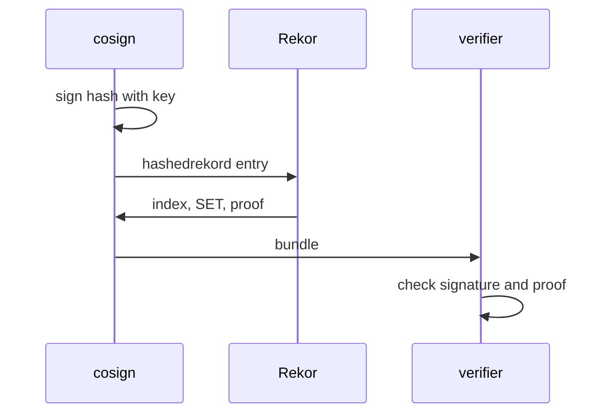

# Why Signing Needs A Transparency Log

A signature answers one question well: did the holder of this private key sign this artifact? It leaves three other questions open. When was it signed? Does anyone else know it was signed? And if the key is stolen, how would you ever find the signatures the thief made? This part shows how a transparency log answers those questions, what Rekor records for each signature, and how you read the state of a log.

## What a log adds to a signature

Think about the stolen key from the landing page again. The thief signs a release on their own machine. The signature is mathematically perfect, so `cosign verify-blob` with the team's public key accepts it. The only thing that can expose the theft is a record that the team itself can read, made at the moment of signing, which the thief cannot remove.

That is what a **transparency log** is: a public list of records that can only be appended to, where anyone can check that nothing was changed or removed. **Append-only** means new entries go at the end and existing entries are never edited or deleted. If every signing tool writes to the log, the team can search the log for its own public key and see every signature ever made with it, including the ones it did not make.

Two properties make such a log useful, and the rest of this module is about how Rekor delivers them:

| Property | What it means | How Rekor proves it |
| --- | --- | --- |
| An entry is really in the log | The log cannot claim to hold an entry it left out | An inclusion proof |
| The log only grew | The log cannot change or drop old entries later | A consistency proof |

Because both are proved with hashes, a verifier does not have to trust the people who run the log. It only has to trust the log's public key, which it uses to check the log's signed statements.

## What Rekor records

**Rekor** is Sigstore's transparency log. A client such as `cosign` sends it one **entry** per signature, and Rekor stores it in a tree that only grows. Every entry gets a **log index**, its position in the log starting at 0, and a **UUID**, a long hexadecimal identifier that names the entry.

An entry has a type, called its **kind**. The kind you meet in this course is `hashedrekord`: it records the SHA-256 hash of the artifact, the signature over that hash, and the public key (or certificate) that verifies it. Rekor v1 also has kinds for signed attestations, such as `dsse` and `intoto`, but the idea is the same. Note what is not in an entry: the artifact itself. Rekor stores a hash, so a log entry never leaks the content of a private file.

The flow below shows where Rekor sits when `cosign` signs a file with a key pair.



The diagram shows `cosign` signing, Rekor recording the entry and answering with its evidence, and a verifier later checking both the signature and the log evidence, all without asking Rekor again.

## Reading the state of the log

Rekor publishes the state of its tree: how many entries it holds, called the **tree size**, and the **root hash**, a single hash that changes if any entry in the tree changes. Rekor signs that pair, so you can check it came from the log. Start with the private log in your playground.

<!-- astrona:playground:renew -->

Open a shell in the workstation, if you do not have one yet:

```sh
kubectl -n workstation exec -it deploy/workstation -- sh
```

Inside it, ask the log for its state:

```sh
rekor-cli loginfo
```

`rekor-cli` sends the request to `http://rekor.localtest.me`, because the environment variable `REKOR_REKOR_SERVER` points it there; the flag `--rekor_server` does the same for one command. The answer lists the tree size, the root hash and the tree ID, which names the Trillian tree that stores this log. `rekor-cli` also checks the log's signature on that state and says whether it verified. With two entries signed by the start script, the tree size is small, around 2.

The same state is available from the Rekor API, which is what `rekor-cli` calls. Ask for it with `curl` and pick out the two numbers that matter:

```sh
curl -s "$REKOR_URL/api/v1/log" | jq '{treeSize, rootHash}'
```

The JSON holds the same tree size and root hash. Keep the root hash in mind: when you add an entry, the tree size grows by one and the root hash changes completely.

## Looking at the public log

The public Rekor at `rekor.sigstore.dev` is run by the Sigstore community as part of the free public-good instance. It works the same way, only much larger. This step needs outbound internet and is optional; you read from the public log, and you never write to it in this course:

```sh
rekor-cli loginfo --rekor_server https://rekor.sigstore.dev
```

Its tree size is very large, because every public signature made with Sigstore tools lands there. The public log also rotates to a new tree from time to time, called a **shard**, so a log is really a series of trees with one active at a time.

You now know what a transparency log adds to a signature, what a `hashedrekord` entry records, and how to read a log's tree size and root hash. The open question is how a single root hash can prove that one particular entry is in a tree of thousands or millions. That is the job of the Merkle tree.

## Common pitfalls

> [!WARNING]
> - **Thinking Rekor stores the artifact.** A `hashedrekord` entry holds the artifact's hash, the signature and the public key. You still need the artifact to check that the hash matches.
> - **Treating a valid signature as proof of when it was made.** Only the log's integrated time and its signed evidence say when an entry was recorded.
> - **Forgetting which log you are talking to.** `rekor-cli` uses `https://rekor.sigstore.dev` unless `--rekor_server` or `REKOR_REKOR_SERVER` says otherwise. In this course the workstation points it at the private log.
> - **Writing lab data to the public log.** The public log is append-only for everyone: anything you upload there stays there. Never sign lab artifacts against it.
