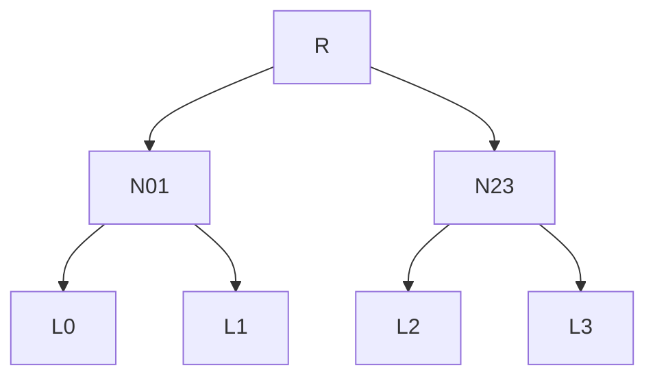

# Merkle Trees And Inclusion Proofs

Rekor can tell you that an entry is at log index 42. Why should you believe it? Downloading the whole log to check would take hours for the public instance. This part shows how a Merkle tree lets the log prove that one entry is in the tree with just a handful of hashes, first by hand on a tree of four entries, then for real with `rekor-cli`.

## Building a tree of four entries

A **Merkle tree** is a binary tree of hashes. Each leaf is the hash of one entry, each inner node is the hash of its two children, and the single hash at the top is the root hash. Rekor builds its tree the way RFC 6962 defines it, with a one-byte prefix that keeps leaves and inner nodes apart:

| Hash | How it is computed |
| --- | --- |
| Leaf hash | `SHA-256(0x00 || entry)` |
| Node hash | `SHA-256(0x01 || left || right)` |

Take a log with four entries, e0 to e3. Their leaf hashes are L0 to L3. The next level combines pairs: N01 is the node hash of L0 and L1, and N23 the node hash of L2 and L3. The root hash R is the node hash of N01 and N23.



The diagram shows the tree for four entries: every leaf hash feeds one node hash, and both node hashes feed the root hash R.

Change one byte of e2 and L2 changes, so N23 changes, so R changes. That is why a single root hash speaks for every entry under it. When a tree size is not a power of two, RFC 6962 splits it at the largest power of two below the size, so the left subtree is always complete; the hashing rules stay the same.

## Following an inclusion proof

An **inclusion proof** is the list of sibling hashes that lets a verifier recompute the root hash from one leaf. To prove that e2 is in the tree, the log sends two hashes: L3, the sibling of L2, and N01, the sibling of N23. The verifier, who has e2, works upward:

1. Compute L2 from e2 with the leaf rule.
2. Compute N23 from L2 and L3 with the node rule.
3. Compute R from N01 and N23 with the node rule.
4. Compare the result with the root hash the log signed.

If they match, e2 is in the tree; if the log had left e2 out or changed it, no list of hashes could produce the signed root. The proof grows with the depth of the tree, not its size: about 20 hashes cover a million entries. The log index matters too, because it tells the verifier on which side of each step the sibling sits.

## Finding the entry of an artifact

Now do it for real. To check an entry you first have to find it, and Rekor v1 keeps a **search index** that maps artifact hashes and public keys to entries. The playground signed `inventory-1.1.0.txt`, so search for it in the workstation shell.

<!-- astrona:playground:renew -->

Search by the artifact file; `rekor-cli` hashes it for you:

```sh
rekor-cli search --artifact /lab/artifacts/inventory-1.1.0.txt
```

The answer is a list of entry IDs, one per entry that records this artifact's hash. Here it is one long hexadecimal string. Rekor v1 may print an 80-character ID: the first 16 characters name the tree, and the last 64 are the UUID. Save it in a variable so you do not have to copy it again:

```sh
ENTRY_ID="$(rekor-cli search --artifact /lab/artifacts/inventory-1.1.0.txt | head -1)"
echo "$ENTRY_ID"
```

Ask for the full entry:

```sh
rekor-cli get --uuid "$ENTRY_ID" --format json | jq .
```

The JSON has the fields `LogIndex`, `IntegratedTime` (when Rekor accepted the entry, in Unix seconds), `UUID`, `LogID` and `Body`, the decoded entry: the kind `hashedrekord`, the artifact's SHA-256 hash, the signature and the public key of `team-a`. The inclusion proof is not part of this output. The Rekor API returns it with the entry, under `verification.inclusionProof`:

```sh
curl -s "$REKOR_URL/api/v1/log/entries/$ENTRY_ID" | jq '.[].verification.inclusionProof'
```

It holds the log index, the tree size and root hash the proof was computed for, the list of sibling hashes, and the checkpoint that signs that root hash.

## Checking the leaf hash yourself

The leaf of a `hashedrekord` entry is its canonicalized body, the exact bytes Rekor stored. You can fetch those bytes from the API and compute the leaf hash with the rule from the table, a zero byte followed by the body:

```sh
BODY="$(curl -s "$REKOR_URL/api/v1/log/entries/$ENTRY_ID" | jq -r '.[].body')"
{ printf '\000'; printf '%s' "$BODY" | base64 -d; } | sha256sum
```

In Rekor v1 the 64-character UUID is the leaf hash of the entry, so the hash you just computed should equal the last 64 characters of `ENTRY_ID`. That is a small but real check: you recomputed the leaf from the stored entry, without trusting any number Rekor printed.

## Verifying the inclusion proof

`rekor-cli verify` does the whole walk for you. It fetches the entry and its inclusion proof, recomputes the root hash from the leaf, checks the checkpoint that the log signed, and checks the signed entry timestamp:

```sh
rekor-cli verify --uuid "$ENTRY_ID"
```

The command prints the root hash, the entry UUID, its index, the tree size, the sibling hashes and the checkpoint it checked them against. If it returns without an error, the inclusion proof verified. The same command takes `--log-index` instead of `--uuid` when you know the position. If any hash in the chain did not fit, it would fail instead of printing a result.

You can now find the entry of any artifact, read what it records, and prove that it is in the tree. What you cannot prove yet is that the tree you checked against is the same tree everyone else sees, and that it never lost an entry. That needs a second kind of proof.

## Common pitfalls

> [!WARNING]
> - **Searching for a file that changed.** `--artifact` hashes the file as it is now. If one byte changed since signing, the search finds nothing, and that is the correct answer.
> - **Mixing up the log index and the UUID.** The index is a position number; the UUID is the leaf hash. Both name the same entry, but they are not interchangeable in a flag: use `--log-index` for one and `--uuid` for the other.
> - **Comparing an 80-character ID with a 64-character UUID.** Compare the last 64 characters; the first 16 only name the tree.
> - **Trusting the printed root hash.** A root hash is only meaningful once you checked the log's signature on it. `rekor-cli verify` does that check; a root hash copied from a web page does not.

## Your mission: Find And Prove A Release Entry

You can now find an artifact's entry by its hash and verify its inclusion proof. The graded lab gives you four release artifacts that were signed out of order, and asks you to find and prove the entry of one of them and record its log index and UUID for an auditor.

The lab runs in its own cluster, so first pause your playground. Nothing in it is lost:

```sh
astrona stop ats-121-playground-010-01
```

Then start the lab:

```sh
astrona run --git ssh://git@github.com/astrona-io/ATS121.git -c sections/section-010/module-01/labs/lab-01
```

The task is on the next page. Solve it on your own first. When you think you are done, send it for grading:

```sh
astrona submit -c sections/section-010/module-01/labs/lab-01
```

When the lab is done, remove it and start your playground again:

```sh
astrona destroy ats-121-lab-010-01
astrona start ats-121-playground-010-01
```
