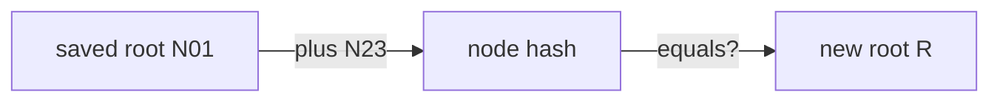

# Consistency Proofs, Checkpoints And Monitors

An inclusion proof shows that an entry is in a tree with a given root hash. But a dishonest log could show you one tree and someone else another, or quietly rebuild its tree without an old entry. This part shows how a consistency proof catches that, what a checkpoint and a signed entry timestamp promise, and who checks them in practice.

## Proving that the log only grew

A **consistency proof** is a short list of hashes that proves a tree of size N is the first N entries of a larger tree, so nothing was changed or removed. Take the four-entry tree again: leaves L0 to L3, node hashes N01 and N23, root R. Say you saved the root of the tree when it had only two entries; at that size the root was N01.

Now the log has four entries and root R. To prove the old tree is the start of the new one, the log sends one hash: N23. You already hold N01, so you compute the node hash of N01 and N23 and compare it with R. If it matches, the first two entries are exactly the ones you saw before. If the log had changed e0 or e1, N01 would differ and no hash could make the numbers fit.



The diagram shows the check: the saved root and the hash from the proof must produce the new root.

For sizes that are not powers of two the proof has a few more hashes, but the idea is the same. Its length grows with the depth of the tree, so even for the public log it stays small.

## Watching the log grow

Seeing a consistency proof needs a log that grows, so add an entry. The playground's key `team-a` is protected with the lab-only password `lab-only-password`. In the workstation shell, first let `rekor-cli` remember the current state.

<!-- astrona:playground:renew -->

`rekor-cli loginfo` saves the state it saw in `~/.rekor/state.json`, and the next call checks consistency against it:

```sh
rekor-cli loginfo
```

Now sign a new artifact. The flag `--signing-config` matters: it tells `cosign` to send the entry to the private log. Without it, `cosign` v3 would use the public-good instance:

```sh
export COSIGN_PASSWORD=lab-only-password
printf 'inventory release 1.2.0\n' > /lab/artifacts/inventory-1.2.0.txt
cosign sign-blob --key /lab/keys/team-a.key \
  --signing-config /lab/signing-config.json \
  --bundle /lab/bundles/inventory-1.2.0.txt.sigstore.json \
  --yes /lab/artifacts/inventory-1.2.0.txt
```

Ask for the log state again:

```sh
rekor-cli loginfo
```

The tree size grew by one and the root hash is different. Because `rekor-cli` kept the earlier state, it also asked Rekor for a consistency proof between the old size and the new one, checked it, and reports that the new tree is consistent with the one it saw before.

## Asking for a consistency proof yourself

You can ask for a consistency proof between any two sizes. Use the size you saw before the new entry as the first size and the current size as the last; here, the tree grew from 2 to 3 entries:

```sh
rekor-cli logproof --first-size 2 --last-size 3
```

If your playground already had more entries, use the two tree sizes `rekor-cli loginfo` printed instead of 2 and 3. The answer holds the hashes of the proof and the root hash of the tree at the last size. The API gives the same through `curl`, which is handy in scripts:

```sh
curl -s "$REKOR_URL/api/v1/log/proof?firstSize=2&lastSize=3" | jq .
```

There is a useful trick hidden here. The `rootHash` in this answer is the root of the tree at `lastSize`. So if you only know a size, you can learn what the root hash was at that size by asking for a proof from size 1 to it. An auditor uses exactly that to check a root hash someone saved earlier.

## Checkpoints and signed entry timestamps

Hashes alone prove that numbers fit together. They do not prove that the log stands behind them. Two signed statements do that, and they promise different things:

| Statement | What the log signs | What it promises |
| --- | --- | --- |
| Checkpoint (signed tree head) | The log's origin, a tree size and the root hash | "This is my tree at this size" |
| Signed entry timestamp (SET) | One entry's body, its integrated time, the log ID and the log index | "I accepted this entry and will add it" |

A **checkpoint** is a short signed note. Read the log's current one from the API:

```sh
curl -s "$REKOR_URL/api/v1/log" | jq -r '.signedTreeHead'
```

The note's first line names the log's origin, the next lines hold the tree size and the root hash in Base64, and after a blank line comes the signature line. Every inclusion proof Rekor returns carries such a checkpoint, so a verifier can check the root hash against the log's key.

A **signed entry timestamp** is Rekor's signature over one entry, returned at once when the entry is accepted. It is a promise, not a proof: it says the entry will be in the log, while an inclusion proof shows that it is. Verifiers use the SET's integrated time as the trusted time of signing when there is no separate timestamp authority.

## Monitors and witnesses

Proofs only help if someone checks them. A **monitor** is a program that watches the log: it checks that each new checkpoint is consistent with the last one, and it can alert when an entry appears for a key or identity it watches. Sigstore publishes a monitor that runs as a GitHub Actions workflow. A **witness** is a third party that checks consistency between checkpoints and co-signs the ones it accepts, so a log cannot show different trees to different people without a witness noticing. Sigstore names omniwitness, from the team that built Trillian, the log storage under Rekor v1.

You can now prove that a log only grew, read a checkpoint, and say what a SET promises compared with an inclusion proof. Together with the inclusion proof, that is everything an auditor needs to hold a log to account without trusting it.

## Common pitfalls

> [!WARNING]
> - **Comparing root hashes of different sizes.** Two root hashes only match when they are for the same tree size. Compare a saved root with the root at that same size, not with today's root.
> - **Treating a SET as an inclusion proof.** A SET is a signed promise made before the entry is in the tree. An inclusion proof shows the entry is there.
> - **Signing without the signing config.** Without `--signing-config /lab/signing-config.json`, `cosign` v3 sends the entry to the public log.
> - **Restarting the Rekor server pod in the lab.** The lab log keeps its signing key in memory. After a restart it signs with a new key, and old trust files no longer match new checkpoints.
