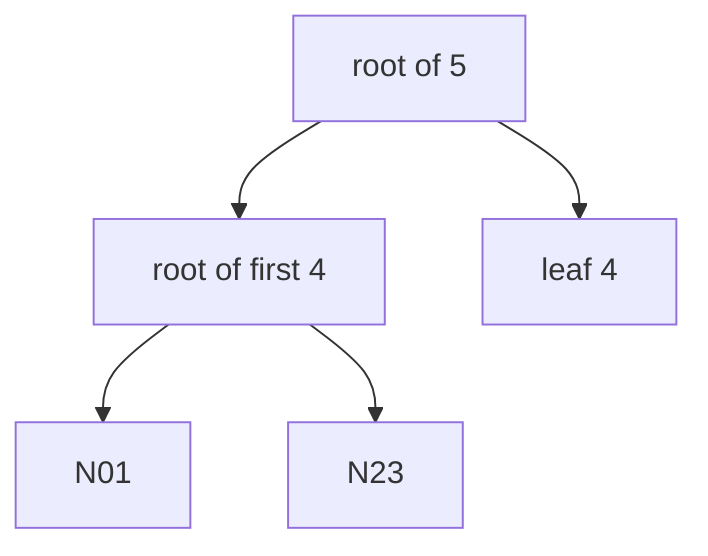

# Proofs For Trees Of Any Size

The hand-built tree had four entries, a power of two, so every subtree was full. A real log never stays at such a size. This part shows how the proof changes when the tree size is not a power of two, how long a proof can be, and why a proof you saved last week no longer matches the log today.

## How the tree is split

RFC 6962 defines the tree for any number of entries. It splits a list of n entries at the largest power of two that is smaller than n. The left part is then always a complete tree, and the right part is a smaller tree built the same way. For five entries the left side holds four, and the right side holds one.



The diagram shows five entries: a complete tree of four on the left, and the fifth leaf hanging directly under the root. Leaves 0 to 3 sit under N01 and N23 and are left out of the drawing.

Two facts follow. First, appending an entry never changes the hash of a complete left subtree, so most of the tree stays as it was. Second, the root hash always changes, because the new leaf joins the right edge and the root is computed from that edge.

## How long a proof is

An inclusion proof holds one sibling hash for each level between the leaf and the root. In a tree of n entries, a proof never needs more than the number of levels, which is the base-2 logarithm of n, rounded up. A tree of 1,000 entries needs at most 10 hashes. A tree of 1,000,000 entries needs at most 20.

A leaf near the right edge of an unbalanced tree can have a shorter proof, because there are fewer levels above it. That is why proofs in a real log do not all have the same length. See it in your playground. First add entries so that the tree size is not a power of two. Sign three more files with the key `team-a`:

<!-- astrona:playground:renew -->

```sh
export COSIGN_PASSWORD=lab-only-password
for n in 1 2 3; do
  printf 'extra artifact %s\n' "$n" > "/lab/artifacts/extra-$n.txt"
  cosign sign-blob --key /lab/keys/team-a.key \
    --signing-config /lab/signing-config.json \
    --trusted-root /lab/trusted-root.json \
    --bundle "/lab/bundles/extra-$n.sigstore.json" \
    --yes "/lab/artifacts/extra-$n.txt"
done
```

The tree now has at least five entries. Read the tree size, then print the number of hashes in the proof of every entry:

```sh
SIZE="$(curl -s "$REKOR_URL/api/v1/log" | jq -r '.treeSize')"
echo "tree size: $SIZE"
i=0
while [ "$i" -lt "$SIZE" ]; do
  count="$(curl -s "$REKOR_URL/api/v1/log/entries?logIndex=$i" | jq '[.[]][0].verification.inclusionProof.hashes | length')"
  echo "index $i: $count hashes"
  i=$((i + 1))
done
```

The counts differ between entries when the tree size is not a power of two, and none of them is larger than the number of levels. The last entry has the shortest proof when it sits alone on the right edge.

## A proof belongs to one tree size

An inclusion proof is a statement about a tree of a given size. It names the tree size and the root hash it was computed for, and its sibling hashes only fit that tree. Save the proof of the first entry now:

```sh
curl -s "$REKOR_URL/api/v1/log/entries?logIndex=0" | jq '[.[]][0].verification.inclusionProof' > /tmp/proof-before.json
jq '{treeSize, rootHash, hashes: (.hashes | length)}' /tmp/proof-before.json
```

Add one more entry, as you did above, and fetch the proof of the first entry again:

```sh
printf 'extra artifact 4\n' > /lab/artifacts/extra-4.txt
cosign sign-blob --key /lab/keys/team-a.key \
  --signing-config /lab/signing-config.json \
  --trusted-root /lab/trusted-root.json \
  --bundle /lab/bundles/extra-4.sigstore.json \
  --yes /lab/artifacts/extra-4.txt
curl -s "$REKOR_URL/api/v1/log/entries?logIndex=0" | jq '[.[]][0].verification.inclusionProof' > /tmp/proof-after.json
diff /tmp/proof-before.json /tmp/proof-after.json
```

The tree size and root hash differ, and so can the sibling hashes. The old proof is still correct for the old tree, and the new one is correct for the new tree. Neither is wrong. A bundle keeps the proof from the moment of signing, which is why it also keeps the tree size and root hash it was made for. A verifier checks the proof against that stored checkpoint, not against today's root.

This also answers a common worry. An old bundle does not stop verifying when the log grows, because its proof, its tree size and its signed checkpoint all belong to the same moment. The log's growth shows up only in a consistency proof between the old size and the new one.

You now know how the tree is split for any size, how long a proof can be, and why a proof is tied to one tree size. The summary of this module follows, with what an auditor keeps from all of it.

## Common pitfalls

> [!WARNING]
> - **Expecting every proof to have the same length.** Proof length depends on the position of the leaf and the tree size.
> - **Checking an old proof against today's root.** A proof only fits the tree size it names. Use the checkpoint stored with it.
> - **Believing an old bundle is broken because the root hash changed.** The root hash changes with every new entry. The bundle's own evidence stays valid.
