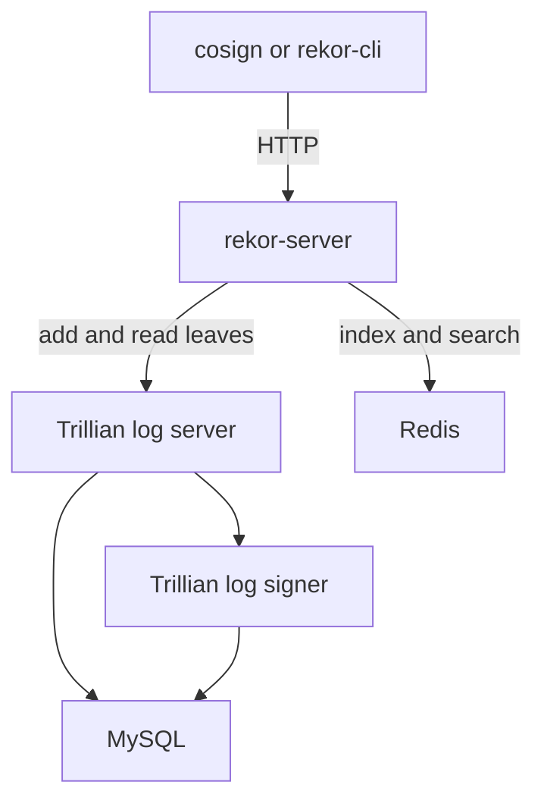

# How Rekor Is Built

When `cosign` uploads an entry, one HTTP request reaches the Rekor server, and a few seconds later the answer holds a log index and a proof. Between the two, several programs have run. An auditor who knows which program does what can tell where a failure comes from: a missing search result, a slow upload or a proof that does not verify. This part names the programs in your playground and says what each one stores.

## The programs behind the API

A Rekor v1 deployment has four parts that matter for this course. The **Rekor server** (`rekor-server`) is the program clients talk to. It exposes the REST API, checks every new entry, signs checkpoints and signed entry timestamps (SETs), and answers search requests. **Trillian** is the storage layer for the Merkle tree. It has two programs: the log server, which answers requests to read and add leaves, and the log signer, which adds new leaves to the tree in batches and computes the new root hash. Trillian keeps its data in a **MySQL** database. **Redis** holds the search index.



The diagram shows that the client only talks to `rekor-server`, which sends the tree work to Trillian and the search work to Redis.

The playground installs all of them with one Helm chart. See the pods for yourself from your own machine, outside the workstation:

<!-- astrona:playground:renew -->

```sh
kubectl -n rekor-system get pods
kubectl -n trillian-system get pods
```

The first namespace holds the Rekor server and Redis. The second holds the Trillian log server, the log signer and MySQL. The pod names carry a random suffix, so yours differ from any text you read.

## What each part stores

The split matters because each store has a different job and a different failure. The Merkle tree is the source of truth: it holds the canonicalized body of every entry as a leaf, in order, and nothing in it can be edited. The search index is only a convenience. It maps artifact hashes, public keys and identities to entry UUIDs so that a client can ask "which entries record this hash?" without reading the whole tree.

That means the index can be wrong without the log being wrong. If Redis lost its data, a search would return nothing for an artifact that is really in the log, and `rekor-cli get --log-index` would still find the entry. An auditor who has a log index or a UUID never needs the index.

The server also holds a signing key. It uses the key to sign checkpoints and SETs. In this playground the key lives in memory, so restarting the Rekor server pod gives the log a new key. A trusted root made before the restart no longer matches new checkpoints. Leave the pod alone.

## Asking the server about itself

The server describes its own state through the API. Ask for it from the workstation shell:

```sh
kubectl -n workstation exec -it deploy/workstation -- sh
```

Inside the shell, ask the log for its state:

```sh
curl -s "$REKOR_URL/api/v1/log" | jq .
```

The answer lists the tree size, the root hash, the tree ID, the signed tree head and the list of inactive shards. The signed tree head is the checkpoint the server signed for the current state.

Rekor also publishes the public key it signs with. Everything the server signs verifies against this key:

```sh
curl -s "$REKOR_URL/api/v1/log/publicKey"
curl -s "$REKOR_URL/api/v1/log/publicKey" -o /tmp/server.pub
diff /tmp/server.pub /lab/rekor.pub && echo same
```

The first command prints a PEM public key. The second compares it with the copy that the playground saved in `/lab/rekor.pub`, which is the key inside the lab trusted root. If the two differ, the server restarted after the trust files were written.

## What the server checks before it adds an entry

The server does not add whatever a client sends. For a `hashedrekord` entry it checks that the request has the right fields, that the public key or certificate parses, and that the signature is valid over the hash. A bad signature returns an error and adds nothing. This is why a log entry is meaningful: someone holding the private key really signed that hash.

The server then canonicalizes the entry, which means it writes the fields in one fixed order and format, so the same entry always produces the same bytes. It hands those bytes to Trillian as a new leaf. The log signer includes the leaf in the next batch, and the server answers with the log index, the inclusion proof and the SET.

You now know the programs behind the API, which store is the source of truth, and what the server checks before it accepts an entry. The next question is what shapes of entry the server accepts.

## Common pitfalls

> [!WARNING]
> - **Treating the search index as the log.** An empty search result does not prove an entry is absent. Only the tree is the record.
> - **Restarting the Rekor server pod.** The in-memory key is lost, and the trust files stop matching new checkpoints.
> - **Looking for the client in the chain.** `cosign` and `rekor-cli` only send HTTP requests. The checks, the signing and the storage happen in the server, Trillian and Redis.
