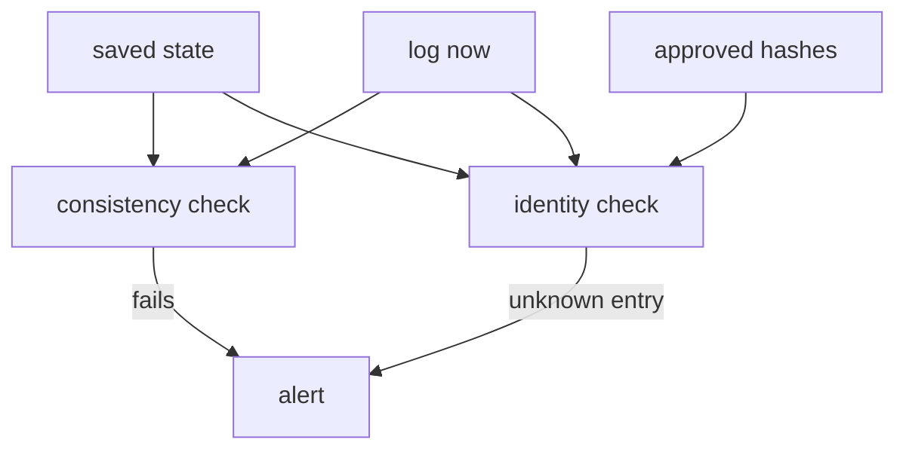

# What A Monitor Checks

A signature that nobody checks protects nothing. Rekor makes every signing event public, but a public record only helps if somebody reads it and notices what does not belong. This part defines a monitor, names the two checks it makes, and shows the state it must keep so that each run compares the log with the one before.

## What a monitor is

A **monitor** is a program that reads a transparency log again and again and checks it against what it saw before. It runs on a schedule, for example once an hour. It does not need to trust the log. It uses the same proofs an auditor uses, and it raises an **alert** when a check fails: a message to a person or a failed job.

Sigstore publishes a monitor, `rekor-monitor`, that runs as a GitHub Actions workflow or as a command. This module builds the checks by hand. The shell versions are short, and they show exactly what the published tool has to do.

## The two checks

A monitor answers two different questions about the log.

| Check | Question | Evidence |
| --- | --- | --- |
| Consistency | Is the log today an extension of the log I saw last time? | A consistency proof between the saved tree size and the current one, and the checkpoint signature |
| Identity | Did a key or identity I care about sign something I do not know about? | The entries added since the last run, filtered by key, compared with a list of approved artifacts |

The consistency check protects against the log itself: a log that rewrote history or dropped an entry. The identity check protects against a key holder: a stolen or misused key. A monitor needs both, because a perfectly honest log still records a thief's signature, and a perfectly careful owner can still be shown a log that has been altered.



The diagram shows both checks reading the saved state and the current log, and the identity check also reading the list of approved hashes. Either check can raise the alert.

## The state a monitor keeps

A monitor that remembers nothing can only say what the log contains. To say what changed, it keeps a small state between runs. Two values are enough: the **tree size** and the **root hash** of the log at the end of the last run. The tree size marks the dividing line for the identity check, since every entry with a log index at or above it is new. The tree size and root hash together feed the consistency check.

The monitor must also keep the state safe. An attacker who can rewrite the saved state can hide an entry by moving the line. Keep it somewhere the signing systems cannot write.

## The list of approved artifacts

The identity check needs one more input: what the owner expects. For a release key, it is the list of SHA-256 hashes of the artifacts the team really released. Any entry by the key whose hash is not on the list is unexpected. The list comes from the release process, not from the log, because the log would only repeat what the thief signed.

## Create the state in the playground

Make the state for your playground log. In the workstation shell, create a folder and save the current tree size and root hash in it:

<!-- astrona:playground:renew -->

```sh
mkdir -p /lab/monitor
curl -s "$REKOR_URL/api/v1/log" | jq '{treeSize, rootHash}' | tee /lab/monitor/state.json
```

The file now holds two fields. Keep it: the next two parts use it.

Make the list of approved hashes from the release artifacts you trust. The playground signed three artifacts; the two with the key `team-a` are releases:

```sh
for name in api-1.0.0 api-1.1.0; do
  sha256sum "/lab/artifacts/$name.txt" | cut -d' ' -f1
done > /lab/monitor/approved-hashes.txt
cat /lab/monitor/approved-hashes.txt
```

The file holds one lower-case hexadecimal hash per line, the same form that a `hashedrekord` entry uses.

You now know the two checks of a monitor, the state it keeps and the list it compares against. What remains is to write the checks.

## Common pitfalls

> [!WARNING]
> - **Keeping the state where the watched key can write.** A signer that can edit the state can hide its own entry.
> - **Building the approved list from the log.** The list must come from the release process. The log also contains the entries you want to catch.
> - **Running only one check.** The consistency check does not see a thief's signature, and the identity check does not see a rewritten log.
