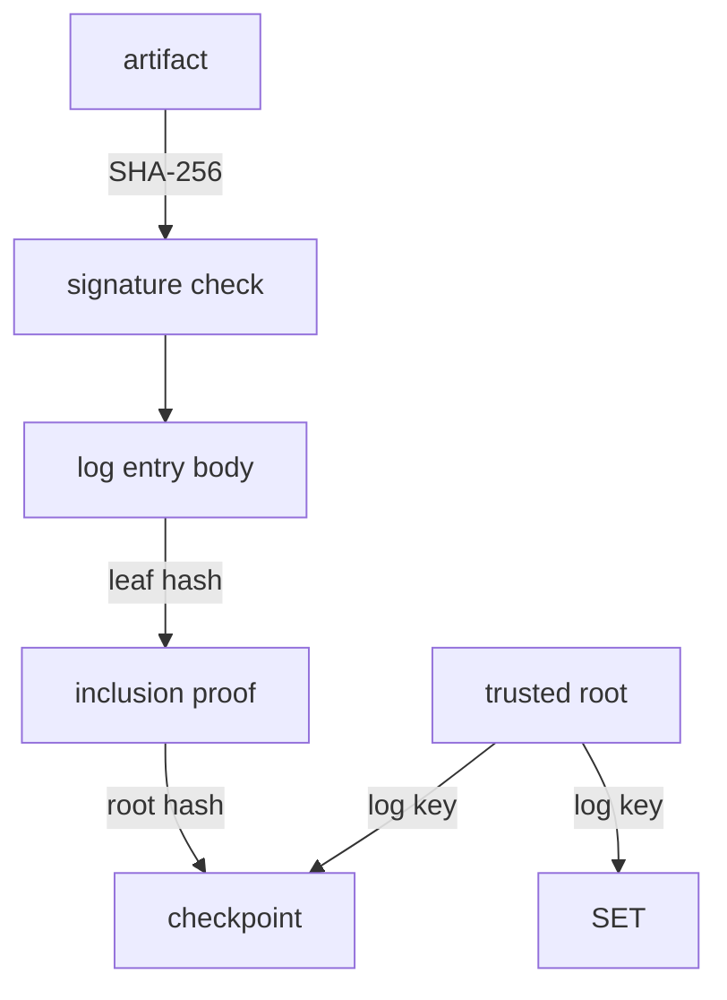

# Verifying A Bundle Offline

A bundle is only evidence if someone checks it, and the check must catch every kind of change: to the artifact, to the signature, or to the log's proof. This part runs `cosign verify-blob` against a good bundle, then breaks a copy in two different ways and reads which check fails each time.

## What cosign checks

`cosign verify-blob` with a bundle and a trusted root does not contact Rekor. It checks, in this order:

1. The signature: the artifact's SHA-256 hash, signed with the private key that belongs to the public key you give.
2. The log entry: the canonicalized body in the bundle records the same hash, signature and key.
3. The inclusion proof: the leaf hash of that body, with the sibling hashes, gives the proof's root hash.
4. The checkpoint: the log's key from the trusted root signed that root hash and tree size.
5. The signed entry timestamp: the log's key signed the entry's body, time, log ID and index.



The diagram shows how the checks chain: the artifact feeds the signature check, the entry body feeds the inclusion proof, and the trusted root's log key checks both the checkpoint and the SET.

## Verifying a good bundle

Start with a bundle that should pass. In the workstation shell, verify `inventory-3.0.0.txt` with the `release` public key and the lab trust root.

<!-- astrona:playground:renew -->

```sh
cosign verify-blob --key /lab/keys/release.pub \
  --trusted-root /lab/trusted-root.json \
  --bundle /lab/bundles/inventory-3.0.0.txt.sigstore.json \
  /lab/artifacts/inventory-3.0.0.txt
```

`cosign` prints that the signature verified. To convince yourself it did not ask the log, note that you gave it no Rekor URL at all: everything came from the bundle and the trusted root.

## Breaking the artifact

Copy the artifact, change one line, and verify the copy with the original bundle:

```sh
cp /lab/artifacts/inventory-3.0.0.txt /tmp/changed.txt
printf 'one more line\n' >> /tmp/changed.txt
cosign verify-blob --key /lab/keys/release.pub \
  --trusted-root /lab/trusted-root.json \
  --bundle /lab/bundles/inventory-3.0.0.txt.sigstore.json \
  /tmp/changed.txt
```

The verification fails, and the error is about the signature or the artifact digest: the hash of the file no longer matches what was signed and logged. The log evidence in the bundle is still perfectly valid; it just belongs to a different file.

## Breaking the inclusion proof

Now leave the artifact alone and change the bundle instead. The sibling hashes in a bundle are Base64 strings, so turning their capital letters into small ones changes the bytes they stand for. Do that to the first sibling hash, and save the result as a new bundle:

```sh
jq '.verificationMaterial.tlogEntries[0].inclusionProof.hashes[0] |= ascii_downcase' \
  /lab/bundles/inventory-3.0.0.txt.sigstore.json > /tmp/tampered.json
cosign verify-blob --key /lab/keys/release.pub \
  --trusted-root /lab/trusted-root.json \
  --bundle /tmp/tampered.json \
  /lab/artifacts/inventory-3.0.0.txt
```

This time the signature is fine, but the verification still fails, and the error is about the transparency log evidence: the changed sibling hash no longer leads to the root hash that the checkpoint signs. That is the point of the proof. Nobody can edit a bundle's log evidence, because the log's signature on the checkpoint would no longer fit.

## The flag that turns the log off

`cosign verify-blob` has a flag `--insecure-ignore-tlog`, which skips every log check. It exists for signatures that were never logged. On a bundle with log evidence it hides exactly the kind of tampering you just saw, so never use it to make a failing verification pass. When a check fails, the useful question is which one, because a failed signature check and a failed proof check mean different things for an incident.

You can now verify a bundle offline, and tell from the failure whether the artifact or the log evidence changed. The last open question is what happens to all of this when the log itself is redesigned.

## Common pitfalls

> [!WARNING]
> - **Verifying with the wrong key.** A bundle signed with another key fails the signature check, even if its log evidence is perfect.
> - **Using `--insecure-ignore-tlog` to get a pass.** It skips the checks that catch tampered log evidence.
> - **Reading every failure as "bad signature".** A changed artifact and a changed proof fail in different checks; read the error.
> - **Using an old trusted root after the log key changed.** The lab log keeps its key in memory; after a restart of the Rekor server pod, rebuild the trust files with `/setup/lab-init.sh`.

## Your mission: Find The Bundles That Do Not Verify

You can now verify bundles offline and tell why one fails. The graded lab gives you five release artifacts with their bundles, and asks you to find exactly the ones that do not verify.

The lab runs in its own cluster, so first pause your playground. Nothing in it is lost:

```sh
astrona stop ats-121-playground-030-01
```

Then start the lab:

```sh
astrona run --git ssh://git@github.com/astrona-io/ATS121.git -c sections/section-030/module-01/labs/lab-01
```

The task is on the next page. Solve it on your own first. When you think you are done, send it for grading:

```sh
astrona submit -c sections/section-030/module-01/labs/lab-01
```

When the lab is done, remove it and start your playground again:

```sh
astrona destroy ats-121-lab-030-01
astrona start ats-121-playground-030-01
```
