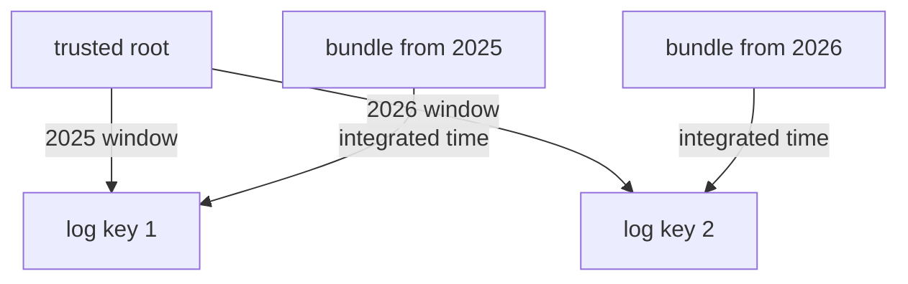

# Trust Roots Over Time

A bundle you save today must still verify in two years. Keys, logs and shards change in that time, and a verifier that only knows today's key rejects yesterday's evidence. The trusted root solves this by listing every key with the time range in which it is valid. This part reads those ranges in the lab's trusted root and explains how `cosign` uses them, and what you must do when a key changes.

## What a validity window is

Each log in the trusted root has a public key and a **validity window**: a start time and, for a key that is retired, an end time. The window says when the log used that key to sign checkpoints and signed entry timestamps. A verifier accepts a signature from the log only if the time it checks falls inside the window of that key.

The time to check comes from the bundle. With Rekor v1 it is the integrated time in the entry. With Rekor v2 it is the time in the RFC 3161 timestamp. Because the time comes from the evidence, an old bundle is checked against the key that was valid then, not against today's key.

## Reading the windows

In the workstation shell, list each log in the lab trusted root with its URL and its validity window.

<!-- astrona:playground:renew -->

```sh
jq '.tlogs[] | {baseUrl, validFor: .publicKey.validFor}' /lab/trusted-root.json
```

The lab trusted root has one log, the private Rekor, and its window has a start time and no end time. A window without an end means the key is still in use. The public-good trusted root has several logs, one for each shard, and the older ones have an end time.

The same structure exists for certificate authorities and timestamp authorities. You can list how many of each the lab trusted root holds:

```sh
jq '{logs: (.tlogs | length), certificateAuthorities: (.certificateAuthorities | length), timestampAuthorities: (.timestampAuthorities | length)}' /lab/trusted-root.json
```

The private lab has no certificate authority and no timestamp authority, because it signs with a key pair and uses Rekor v1. A keyless setup would list both.

## Why old bundles keep working

When the operator of a log rotates its key or starts a new shard, the new key gets a start time and the old key gets an end time. Both stay in the trusted root. A bundle made last year has an integrated time inside the old window, so `cosign` picks the old key and verifies it. A bundle made after the rotation falls inside the new window.



The diagram shows that the trusted root keeps both keys and that the time in each bundle selects the key.

## What goes wrong with a stale trusted root

A verifier needs a trusted root that is new enough to contain the key that signed the bundle. If a log starts a new shard and the verifier still holds the old trusted root, bundles from the new shard fail with a message that no matching log key was found. The fix is to refresh the trusted root, not to skip the log checks.

The lab has the same problem in a sharper form. The private Rekor keeps its signing key in memory, so a restart creates a new key. Every trusted root made before the restart no longer matches new checkpoints. This is why the lab text says never to restart the Rekor server pod.

## Keep the trusted root with the bundle

For long-term evidence, store the trusted root that was valid when you verified the bundle, next to the bundle. If the public-good root later drops a retired key, you can still show how the bundle verified at the time. This does not replace verifying with a current root. It gives you a record.

You now know that a trusted root lists keys with validity windows, that the time in the bundle selects the key, and that a stale root is a reason to refresh and not to skip checks. The next question is what other kinds of evidence a log can hold, besides a signature over a file.

## Common pitfalls

> [!WARNING]
> - **Verifying with a trusted root from before a rotation.** New bundles fail with no matching key. Refresh the root.
> - **Deleting retired keys from a trusted root.** Old bundles then stop verifying.
> - **Reading "no end time" as "never expires".** It means the key was not retired when the root was made.
