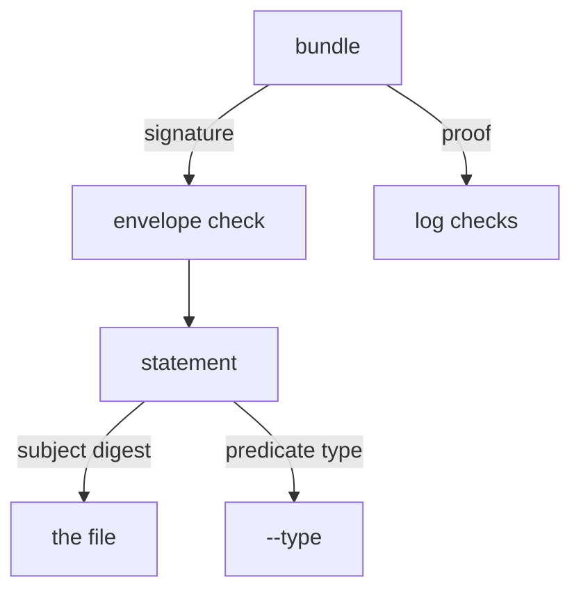

# Verifying An Attestation

An attestation is only useful if the consumer checks it, and the check has one more question than a plain signature: is this the kind of claim the consumer wanted? This part verifies an attestation bundle offline with `cosign verify-blob-attestation`, then asks for a different predicate type and reads the failure.

## What the command checks

`cosign verify-blob-attestation` does the checks of `verify-blob`: the signature over the envelope, the log entry, the inclusion proof, the checkpoint and the signed entry timestamp. It adds two checks of the statement. The subject digest must equal the SHA-256 hash of the file you pass, and the predicate type must equal the type you ask for with `--type`.



The diagram shows that the envelope signature and the log checks come from the bundle, while the statement is compared with the file and with the type you request.

## Verifying a good attestation

<!-- astrona:playground:renew -->

The bundle `/tmp/inventory-4.1.0.att.sigstore.json` comes from `cosign attest-blob`. If it does not exist in your workstation, create it first:

```sh
export COSIGN_PASSWORD=lab-only-password
cosign attest-blob --key /lab/keys/release.key \
  --predicate /lab/predicate.json \
  --type https://astrona.io/release-check/v1 \
  --signing-config /lab/signing-config.json \
  --trusted-root /lab/trusted-root.json \
  --bundle /tmp/inventory-4.1.0.att.sigstore.json \
  --yes /lab/artifacts/inventory-4.1.0.txt
```

Then verify it. The command needs the public key, the trusted root, the bundle, the type URI and the file:

```sh
cosign verify-blob-attestation --key /lab/keys/release.pub \
  --trusted-root /lab/trusted-root.json \
  --bundle /tmp/inventory-4.1.0.att.sigstore.json \
  --type https://astrona.io/release-check/v1 \
  /lab/artifacts/inventory-4.1.0.txt
```

`cosign` prints that the attestation verified. No Rekor URL was given: everything came from the bundle and the trusted root.

## Asking for the wrong type

Run the same check, but ask for a different predicate type:

```sh
cosign verify-blob-attestation --key /lab/keys/release.pub \
  --trusted-root /lab/trusted-root.json \
  --bundle /tmp/inventory-4.1.0.att.sigstore.json \
  --type https://astrona.io/sbom/v1 \
  /lab/artifacts/inventory-4.1.0.txt
```

The verification fails, and the error says that the predicate type does not match. The signature and the log evidence are fine. The consumer asked for a claim of another kind, and a claim of one kind must not stand in for another.

## Using the wrong file

Verify the bundle against the other artifact:

```sh
cosign verify-blob-attestation --key /lab/keys/release.pub \
  --trusted-root /lab/trusted-root.json \
  --bundle /tmp/inventory-4.1.0.att.sigstore.json \
  --type https://astrona.io/release-check/v1 \
  /lab/artifacts/inventory-4.0.0.txt
```

This fails too, because the subject digest in the statement is the hash of `inventory-4.1.0.txt`. An attestation about one file cannot be moved to another file.

## What a pass means

A pass says that the key holder signed a statement with this predicate type about these exact bytes, and that the log recorded it. It does not say that the predicate is true. A scan result that says "no findings" is a claim by whoever ran the scan. The consumer decides whether to trust that signer, and a monitor can watch what that key attested.

You now know how to verify an attestation, and that the predicate type and the subject digest are part of the check. The graded lab asks you to produce and verify an attestation of your own and to record its log entry.

## Common pitfalls

> [!WARNING]
> - **Using `verify-blob` for an attestation.** It expects a plain signature and fails on a bundle with an envelope.
> - **Skipping `--type`.** The check then does not pin the kind of claim.
> - **Reading a pass as "the claim is true".** It proves who signed it and that it was logged.

## Your mission: Attest A Release Artifact

You can now sign, log and verify an attestation. The graded lab gives you a release artifact and a check result, and asks you to produce an attestation bundle with a given predicate type, verify it offline, and record the log entry.

The lab runs in its own cluster, so first pause your playground. Nothing in it is lost:

```sh
astrona stop ats-121-playground-030-02
```

Then start the lab:

```sh
astrona run --git ssh://git@github.com/astrona-io/ATS121.git -c sections/section-030/module-02/labs/lab-01
```

The task is on the next page. Solve it on your own first. When you think you are done, send it for grading:

```sh
astrona submit -c sections/section-030/module-02/labs/lab-01
```

When the lab is done, remove it and start your playground again:

```sh
astrona destroy ats-121-lab-030-02
astrona start ats-121-playground-030-02
```
